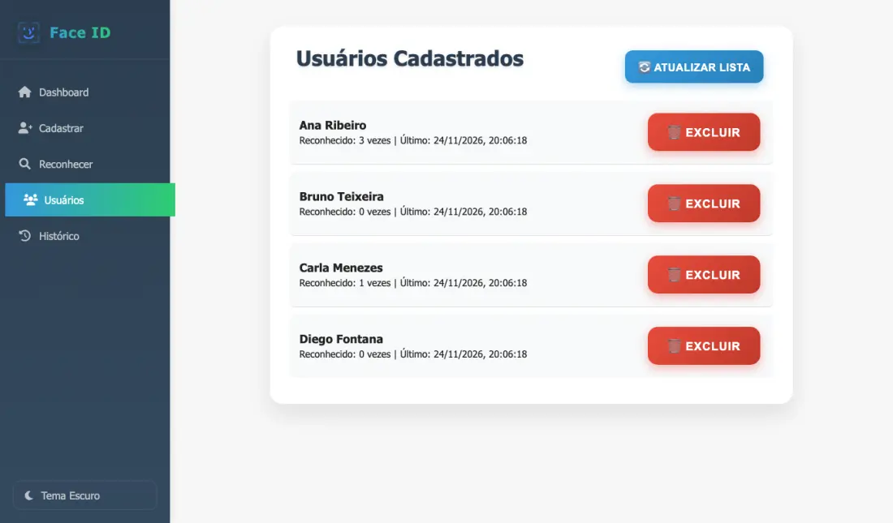
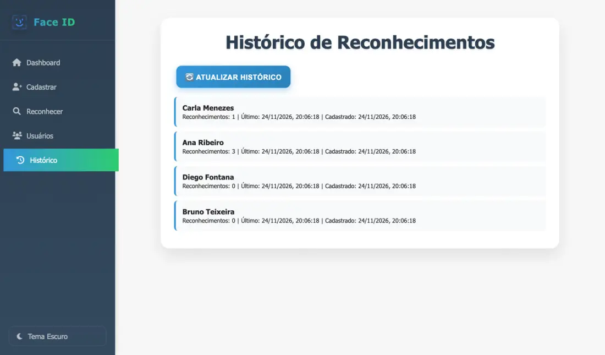
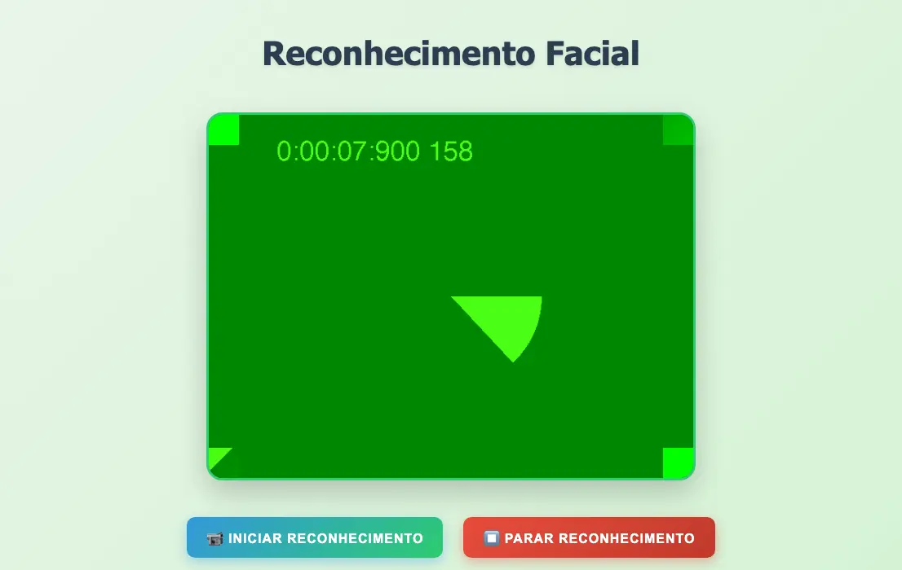
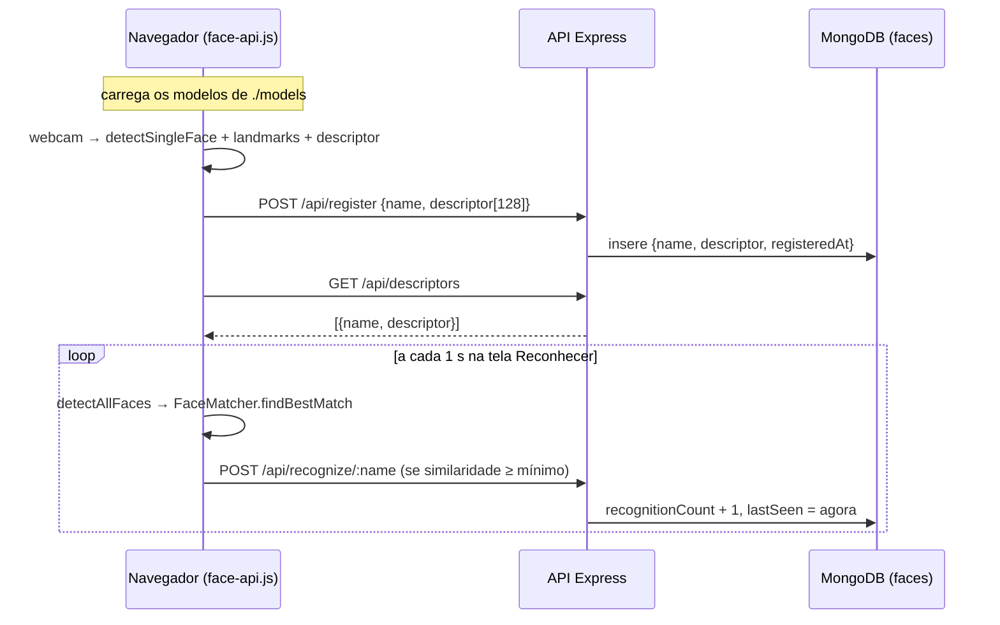

# Face ID - Sistema de Reconhecimento Facial

Reconhecimento facial em tempo real no navegador: a pessoa se cadastra pela webcam, o [face-api.js](https://github.com/justadudewhohacks/face-api.js) transforma o rosto em um descritor de 128 números e uma API Express guarda esses vetores no MongoDB. Depois, a tela de reconhecimento compara cada rosto da câmera com os cadastrados e conta quantas vezes cada pessoa foi vista.


| Usuários cadastrados | Histórico | Reconhecimento com a câmera |
| --- | --- | --- |
|  |  |  |

Os nomes são fictícios e foram cadastrados com descritores aleatórios pela API. A câmera da última imagem é o vídeo sintético de teste do Chromium, por isso não há rosto detectado.

## Funcionalidades

- **Cadastro**: abre a webcam, detecta um único rosto, extrai o descritor e salva com o nome digitado.
- **Reconhecimento**: a cada 1 segundo detecta todos os rostos do vídeo, compara com os cadastrados e desenha uma caixa verde com nome e similaridade. Um controle deslizante define a similaridade mínima (30% a 90%, padrão 70%).
- **Usuários**: lista com número de reconhecimentos e último acesso, com exclusão.
- **Histórico**: pessoas ordenadas pelo último reconhecimento.
- Tema claro e escuro e layout responsivo (desktop, tablet e celular).

## Como funciona



- Nenhuma imagem sai do navegador: só o nome e o vetor de 128 números vão para a API.
- Similaridade = `1 - distância euclidiana` entre descritores. O `FaceMatcher` usa limite de distância 0,6 e, depois, a tela aplica o mínimo de similaridade escolhido no controle.
- Modelos usados: `TinyFaceDetector`, `FaceLandmark68Net`, `FaceRecognitionNet` e `FaceExpressionNet` (carregado, mas não usado). Os pesos estão versionados em `models/`.
- O mesmo `server.js` serve a API e os arquivos estáticos da interface.

### Documento no MongoDB

Coleção `faces`, no banco definido na `MONGO_URI`:

| Campo | Tipo | Observação |
|---|---|---|
| `name` | String | obrigatório, único; é a chave usada nas rotas |
| `descriptor` | [Number] | obrigatório; 128 valores vindos do face-api.js |
| `registeredAt` | Date | data do cadastro |
| `recognitionCount` | Number | começa em 0 |
| `lastSeen` | Date | último reconhecimento (no cadastro, a data do cadastro) |

## Stack

- Frontend: HTML, CSS (separado em base, componentes, seções e temas), JavaScript em módulos, face-api.js, WebRTC (`getUserMedia`) e Canvas.
- Backend: Node.js, Express 4, Mongoose 7, dotenv, CORS.
- Banco: MongoDB (Atlas ou local).

## Como rodar

### Pré-requisitos

- Node.js 18 ou superior
- MongoDB: uma conta no [MongoDB Atlas](https://www.mongodb.com/cloud/atlas) ou um MongoDB local
- Navegador com webcam. `getUserMedia` só funciona em `localhost` ou HTTPS.

### Passos

```bash
git clone https://github.com/PeSzpak/face-id-api.git
cd face-id-api
npm install
```

Crie um `.env` na raiz:

```env
PORT=3001
MONGO_URI=mongodb+srv://usuario:<sua-senha>@cluster.mongodb.net/face_recognition_db?retryWrites=true&w=majority
```

Para testar sem o Atlas, um MongoDB local em Docker serve:

```bash
docker run -d --name face-id-mongo -p 27017:27017 mongo:7
# MONGO_URI=mongodb://localhost:27017/face_recognition_db
```

| Variável | Padrão | Uso |
|---|---|---|
| `PORT` | `3001` | Porta da API e da interface |
| `MONGO_URI` | (obrigatória) | String de conexão do MongoDB |

Suba o servidor e abra http://localhost:3001:

```bash
npm start      # ou npm run dev, com nodemon
```

No Atlas, libere o IP da sua máquina em **Network Access** e crie um usuário de banco. A coleção `faces` é criada no primeiro cadastro.

## Uso

1. **Cadastrar**: digite o nome, clique em **Iniciar câmera**, posicione o rosto e clique em **Capturar e cadastrar**.
2. **Reconhecer**: clique em **Iniciar reconhecimento**. Rostos acima da similaridade mínima ganham uma caixa verde com o nome.
3. **Usuários** e **Histórico**: acompanhe os contadores e exclua cadastros.

O limiar padrão fica em `scripts/modules/recognition.js` (`similarityThreshold = 0.7`) e o limite do `FaceMatcher` em `scripts/modules/models.js` (`0.6`).

## API

| Método | Rota | O que faz |
|---|---|---|
| POST | `/api/register` | Cadastra `{ name, descriptor }`. 400 se faltar campo ou o nome já existir |
| GET | `/api/faces` | Lista as pessoas (sem o descritor) |
| GET | `/api/descriptors` | Nomes e descritores, para o reconhecimento |
| POST | `/api/recognize/:name` | Soma 1 ao contador e atualiza `lastSeen`. 404 se o nome não existe |
| DELETE | `/api/faces/:name` | Remove a pessoa. 404 se o nome não existe |
| GET | `/api/history` | Pessoas ordenadas pelo último reconhecimento |

```bash
curl -X POST "http://localhost:3001/api/recognize/Ana%20Ribeiro"
# {"message":"Recognition count updated for Ana Ribeiro","recognitionCount":4}
```

- OpenAPI 3.0: [`docs/openapi.yaml`](docs/openapi.yaml). Para ver: cole em https://editor.swagger.io ou rode `npx @redocly/cli@1.34.3 preview-docs docs/openapi.yaml`.
- Postman: importe [`docs/postman/face-id-api.postman_collection.json`](docs/postman/face-id-api.postman_collection.json) (`baseUrl` em `http://localhost:3001`, variável `name` com o nome usado nas rotas).

## Estrutura

```
.
├── server.js             # API Express + Mongoose e arquivos estáticos
├── index.html            # casca da interface (sidebar e seções)
├── face-api.min.js       # face-api.js
├── models/               # pesos dos modelos do face-api.js
├── scripts/
│   ├── script.js         # inicialização da aplicação
│   ├── database.js       # chamadas à API (DatabaseManager)
│   └── modules/          # dashboard, register, recognition, users, history, models, navigation, utils
├── styles/               # base, components, sections, responsive, themes
├── images/logo/          # ícone
└── docs/                 # openapi.yaml, coleção Postman e imagens
```

## Limitações conhecidas

- **Sem autenticação**: qualquer um com acesso à API lista, baixa os descritores e apaga cadastros. Descritores faciais são dados biométricos; não exponha a API publicamente assim.
- `express.static(".")` publica a pasta inteira do projeto, incluindo `server.js` e `package.json`. O `.env` não sai porque o Express ignora arquivos que começam com ponto.
- Enquanto a pessoa continua na frente da câmera, o contador sobe a cada segundo, então "reconhecimentos" mede segundos visto, não visitas.
- Os descritores são recarregados quando o app abre e depois de cadastrar ou excluir; um cadastro feito em outra aba só entra no reconhecimento depois de recarregar a página.
- O nome é a chave única: duas pessoas com o mesmo nome não podem ser cadastradas, e o nome vai na URL de `recognize` e `delete`.
- A API não valida o tamanho do descritor.
- `server.js` passa `useNewUrlParser` e `useUnifiedTopology`, opções que o Mongoose 7 ignora.
- O `FaceExpressionNet` é baixado e carregado, mas nenhuma tela usa expressões.
- Não há arquivo `LICENSE` no repositório, nem testes automatizados.

## Suporte

- [Documentação do face-api.js](https://justadudewhohacks.github.io/face-api.js/docs/)
- [Documentação do MongoDB Atlas](https://www.mongodb.com/docs/atlas/)
